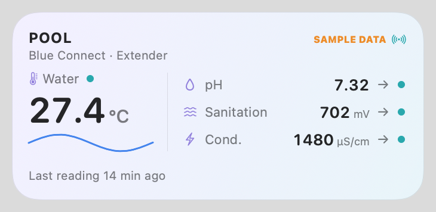
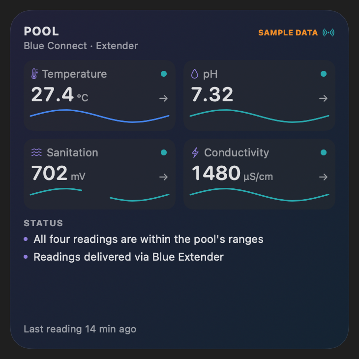
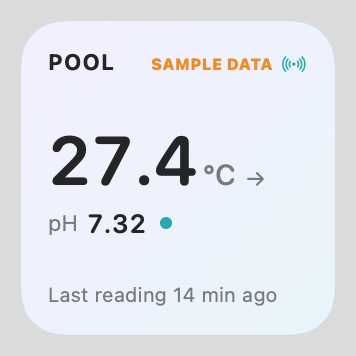

# Pool Monitor: macOS desktop widget

A SwiftUI host app plus a WidgetKit extension showing the Blue Connect's **temperature, pH, sanitation (ORP, mV) and conductivity (µS/cm)** on the macOS desktop. It's backed by the verified BlueRiiot cloud calls documented in `../blueriiot-re/API_SPECIFICATION.md`. Architecture decisions are in [IMPLEMENTATION_NOTES.md](IMPLEMENTATION_NOTES.md).

| Medium | Large | Small |
|---|---|---|
|  |  |  |

Screenshots use sample data, labeled "SAMPLE DATA" in the header. Production views never show sample values; the widget gallery preview is the only place they can appear, and it's labeled too.

## Build and install

Requirements: Xcode 27, macOS 14+, and an Apple Development identity. The project is configured for the original author's team. To build under your own team, replace the Team ID everywhere it occurs (`DEVELOPMENT_TEAM` in the project, both `.entitlements` files, `SnapshotStore.appGroupID`, `dist/ExportOptions.plist`, `package.sh`, `tools/gen_pbxproj.py`), because the App Group ID is team-prefixed.

```bash
cd PoolWidget
xcodebuild build -project PoolWidget.xcodeproj -scheme PoolMonitor -configuration Debug -destination 'platform=macOS' -derivedDataPath build/dd -allowProvisioningUpdates
```

```bash
rm -rf ~/Applications/PoolMonitor.app && cp -R build/dd/Build/Products/Debug/PoolMonitor.app ~/Applications/ && open ~/Applications/PoolMonitor.app
```

Tests (parsing, timestamps, units, freshness, snapshot migration, SigV4 against a botocore vector):

```bash
xcodebuild test -project PoolWidget.xcodeproj -scheme PoolMonitorTests -destination 'platform=macOS' -derivedDataPath build/dd
```

Render every size × state × light/dark to PNG (the sandbox restricts output to the app container):

```bash
build/dd/Build/Products/Debug/PoolMonitor.app/Contents/MacOS/PoolMonitor --render-previews ~/Library/Containers/com.askasen.PoolMonitor/Data/tmp/renders
```

## Package for distribution

```bash
./package.sh               # Release archive → Developer ID export → credential audit → signed dist/PoolMonitor.dmg
./package.sh --notarize    # additionally notarize + staple (one-time setup below)
```

The package never contains credentials. Email and password exist only in the macOS Keychain of the Mac where you sign in; readings live in the App Group container. Neither is part of the app bundle. `package.sh` **fails the build** if any value from `../blueriiot-re/.env` or the captured account data (email, password, device serial, hardware number, pool ID and name, Extender MAC), any AWS key or JWT pattern, or a home-folder path appears in any file of the bundle.

**One-time notarization setup** (you run this; it stores an app-specific password in your Keychain). Either an app-specific password (account.apple.com → Sign-In and Security → App-Specific Passwords) or, more reliably, an App Store Connect API key (Users and Access → Integrations → Team Keys):

```bash
xcrun notarytool store-credentials PoolMonitorNotary --apple-id YOUR_APPLE_ID_EMAIL --team-id YOUR_TEAM_ID
```

```bash
xcrun notarytool store-credentials PoolMonitorNotary --key ~/Downloads/AuthKey_KEYID.p8 --key-id KEYID --issuer ISSUER_ID
```

Without notarization the DMG installs fine on this Mac. On other Macs, Gatekeeper blocks the first launch until it's allowed in System Settings → Privacy & Security.

## First run

1. Open **Pool Monitor**, enter your BlueRiiot email and password, and click **Sign in**. They're stored in the macOS Keychain.
2. Right-click the desktop → **Edit Widgets…** → search "Pool" → drag **Pool Status** (Small, Medium or Large) onto the desktop.
3. Optional: in the app's settings, enable **Open at login** so refreshing continues from the menu bar (drop icon).

## How data flows

```
BlueRiiot cloud ──(host app, every 30 min while running)──▶ App Group snapshot.json ──▶ widget timeline
```

- The widget never makes network calls. It renders the last snapshot immediately.
- The snapshot (`~/Library/Group Containers/<TEAM_ID>.com.askasen.PoolMonitor/snapshot.json`) holds readings, 24 h history and server ranges only. It has no credentials or tokens; a unit test checks this.
- The sensor measures about every 72 min. "Last reading" is always the **sensor's measurement time**, not the fetch time.
- macOS decides when widgets actually redraw. The app requests a reload after each refresh (throttled to once per 5 min).

## States

| State | Shown when | Footer |
|---|---|---|
| Fresh | last refresh OK, reading < 3 h old | `Last reading 14 min ago` |
| Stale | reading ≥ 3 h old | `Last reading 5 h ago` (orange, clock icon) |
| Offline | last refresh failed | `Unable to refresh · reading 9 h ago` + cached values |
| Auth needed | sign-in rejected | `Sign in to refresh` |
| Not configured | no credentials | `Open app to connect BlueRiiot` |
| Partial | metric missing | `—` for that metric |
| No history | < 4 points in 24 h | sparkline and arrow omitted |

In-range, out-of-range and no-range states use different **shapes** (dot, exclamation badge, hollow ring) as well as colours, so they stay readable in the desktop's monochrome "vibrant" rendering. They're based only on the pool's ranges as provided by BlueRiiot. The widget gives no dosing advice and makes no safety claims.

Deep links: `poolmonitor://pool`, `poolmonitor://metric/<temperature|ph|orp|conductivity>`.

## Known limitations

- Only one pool and device (the first) is shown. Pool selection via App Intent is not implemented; the account has a single pool.
- Change arrows compare the latest reading with an actual reading 24 h (±3 h) earlier. If the cloud has a gap there, no arrow is shown.
- With the app quit and "Open at login" off, the widget keeps showing the last snapshot and marks it stale.
- The reference design image (`863FE53C-…png`) wasn't available, so the style follows the spec's description.
- Widget sizes for in-app previews are measured from this Mac (large ≈ 345 × 345 pt). Other displays may differ slightly.

## Troubleshooting

- **Widget not in gallery:** launch the app once from `~/Applications`. Check registration with `pluginkit -m -v -i com.askasen.PoolMonitor.Widget`.
- **Widget shows "Open app to connect":** the app hasn't written a snapshot yet. Open it and sign in.
- **Logs:** `log stream --predicate 'subsystem == "com.askasen.PoolMonitor"'`
