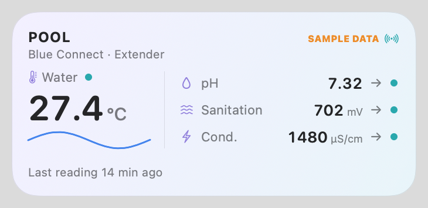

# Blueriiot Pool Monitor

Unofficial tools for the **Blueriiot Blue Connect** pool sensor, built on a documented read-only description of the Blueriiot cloud API.

| Folder | What's in it |
|---|---|
| [`blueriiot-re/`](blueriiot-re/) | **API documentation** ([developer reference](blueriiot-re/API_REFERENCE.md), [evidence-backed spec](blueriiot-re/API_SPECIFICATION.md)), a Python client with full measurement history, CSV export, and a small web dashboard |
| [`PoolWidget/`](PoolWidget/) | **Pool Monitor**: a native macOS app plus desktop widgets (small, medium, large) showing temperature, pH, ORP and conductivity, with range bars and history charts |



## Highlights

- Full measurement **history** via `GET swimming_pool/{pool}/blue/{serial}/measures`, which isn't in the official automation API. Raw readings about every 72 min, all metrics per point.
- Auth: login → temporary AWS (Cognito) credentials → SigV4. Implemented in Python (botocore) and dependency-free Swift (CryptoKit), cross-checked against the same test vector.
- Read-only by design. Credentials stay local (`.env` for Python, the macOS Keychain for the app) and never appear in logs, snapshots or packages.

## Quick start

```bash
cd blueriiot-re && python3.12 -m venv .venv && .venv/bin/pip install -r requirements.txt
cp .env.example .env    # add your Blueriiot email/password
.venv/bin/python examples/export_history.py --days 30
```

For the macOS app see [`PoolWidget/README.md`](PoolWidget/README.md).

## Disclaimer

Not affiliated with or endorsed by Blueriiot / Fluidra. The mobile-app API is undocumented and may change without notice. Use it only with your own account, poll gently (new data arrives about every 72 minutes), and don't use it to change device or account settings.

## License

[Apache 2.0](LICENSE)
